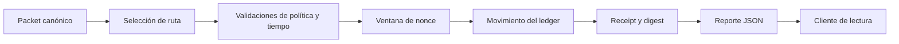

# ObsidianDTL


ObsidianDTL es un relayer DTL escrito en C para transportar instrucciones
económicas entre dominios. El runner modela rutas primarias y alternativas,
recibos de confirmación, ventanas de nonce, control de duplicados y reportes
JSON deterministas para conciliación e integración.

El servicio es autocontenido: las ejecuciones de referencia cargan dominios,
cuentas, rutas y packets en memoria y no requieren nodos ni bases de datos
externas. El repositorio describe un artefacto de código; no certifica un
despliegue operativo externo.

## Componentes

- `src/obsidian.h`: tipos publicos, limites de capacidad y API interna.
- `src/ledger.c`: registro de dominios, cuentas, rutas, eventos y digest de
  estado.
- `src/nonce.c`: ventanas de nonce por dominio con rango aceptado y slots
  consumidos.
- `src/transfer.c`: validacion de packets, seleccion de ruta, receipts y
  movimiento contable.
- `src/scenario.c`: fixtures y escenarios CLI de referencia.
- `src/script.c`: parser de escenarios externos en formato lineal.
- `src/report.c`: serializacion JSON para tests y consumidores externos.
- `tests/node`: tests de integracion que ejecutan el binario compilado.
- `client/report-client.mjs`: proyección de liquidez, fees y disponibilidad de
  rutas a partir de reportes JSON, sin modificar el ledger.
- `scripts/build.mjs`: compilacion portable con GCC, Clang o MSVC.
- `docs/`: runbook operativo, referencia de scripting y notas de receipts.
- `examples/`: scripts `.obs` pequenos para pruebas manuales.

## Modelo Operativo

Un packet economico declara:

- dominio logico de origen;
- dominio destino;
- nonce;
- importe bruto;
- fee maximo aceptado;
- beneficiario;
- tipo de instruccion;
- expiracion temporal.

Una ruta define el transporte operativo autorizado para mover packets entre un
origen logico y un destino. Las rutas tienen relayer asignado, fee fijo, demora
maxima de confirmacion, prioridad y estado activo.

El runner ejecuta cada entrega en cinco fases:

1. carga del packet y de la ruta seleccionada;
2. validacion de compatibilidad de dominios, fees y expiracion;
3. verificacion de ventana de nonce;
4. aplicacion contable sobre el dominio de origen y cuentas receptoras;
5. emision de receipt y digest de estado.



En una entrega nominal de 1 000 000 000 unidades con fee de 20 000, el vault
del dominio de origen se reduce en 1 000 000 000, el beneficiario recibe
999 980 000 y el relayer 20 000. Las magnitudes son enteros sin decimales
implícitos; `conservation_ok` verifica que el total global se conserva. El
digest del packet vincula la instrucción económica y el receipt documenta la
ruta efectivamente utilizada.

## Escenarios CLI

El binario acepta un escenario opcional:

```bash
dist/obsidian-dtl snapshot
dist/obsidian-dtl direct
dist/obsidian-dtl expiry
dist/obsidian-dtl duplicate
dist/obsidian-dtl late
dist/obsidian-dtl fallback
dist/obsidian-dtl routing
```

Si no se pasa argumento, se ejecuta `direct`.

Cada escenario devuelve JSON con:

- superficie registrada de dominios, cuentas y rutas;
- contadores de packets y receipts;
- balances por dominio y cuenta;
- estadisticas de nonces por dominio;
- entregas y fallos por ruta;
- packet log y receipt log;
- conservacion de suministro;
- digest final de estado.

Para obtener una vista resumida sin cambiar el reporte original:

```bash
dist/obsidian-dtl direct > direct.json
npm run inspect -- direct.json
```

El cliente calcula utilización de liquidez por dominio y tasa de entregas por
ruta. Rechaza importes JSON mayores que el entero seguro de JavaScript; para
libros mayores se requiere un parser de enteros de precisión arbitraria.

## Scripts De Escenario

Tambien se puede ejecutar un archivo lineal:

```bash
dist/obsidian-dtl script ./scenario.obs
```

Comandos soportados:

```text
SCENARIO <name>
RESET
EMPTY
DOMAIN <id> <label> <vault>
ACCOUNT <id> <label> <balance>
ROUTE <id> <logical_origin> <transport_origin> <target> <relayer> <fee> <max_delay> <priority> <active>
PACKET <id> <logical_origin> <target> <sender> <beneficiary> <nonce> <amount> <max_fee> <ttl> <kind>
DELIVER <packet_id> <route_id> <confirmation_delay>
TRY_DELIVER <packet_id> <route_id> <confirmation_delay>
QUOTE <logical_origin> <target> <amount> <max_fee>
ADVANCE <delta>
CLOCK <value>
```

`RESET` carga el fixture por defecto. `EMPTY` limpia el ledger para crear un
fixture manual. `TRY_DELIVER` registra el rechazo en el reporte sin hacer fallar
el script. `QUOTE` selecciona una ruta valida sin mover balances.

Ejemplo:

```text
SCENARIO mesa-retail
PACKET pkt-101 edge core alice merchant 101 100000000 50000 12 release
DELIVER pkt-101 edge-direct 1
```

## Requisitos

- Node.js `20` o superior.
- Un compilador C:
  - Linux/macOS: `cc`, `gcc` o `clang`.
  - Windows: Visual Studio Build Tools con componente C++ o un GCC/Clang en
    `PATH`.

## Comandos

Compilar:

```bash
npm run build
```

Tests:

```bash
npm test
```

Validacion completa:

```bash
npm run ci
```

Scripts Bash equivalentes:

```bash
bash scripts/tests.sh
bash scripts/ci.sh
```

## CI

El workflow de GitHub Actions ejecuta:

1. checkout del repositorio;
2. instalacion de Node.js;
3. `npm ci`;
4. validacion de formato local;
5. compilacion del binario C;
6. tests de integracion con `node:test`.

Dependabot revisa dependencias npm y GitHub Actions semanalmente.

El workflow valida Linux y Windows en pushes y PR. La publicación estable
comprueba además que `main`, `production` y el tag anotado `v1.0.0` resuelven
al mismo commit.

## Documentación y versión

- [Arquitectura](docs/ARQUITECTURA.md)
- [Modelo económico](docs/MODELO_ECONOMICO.md)
- [Operación](docs/OPERATIONS.md)
- [Receipts y nonces](docs/RECEIPTS.md)
- [Formato de scripts](docs/SCRIPTING.md)
- [Política de seguridad](SECURITY.md)
- [Historial de cambios](CHANGELOG.md)

`Production 1.0.0` nombra el release del código y no implica un despliegue en
una red externa.
