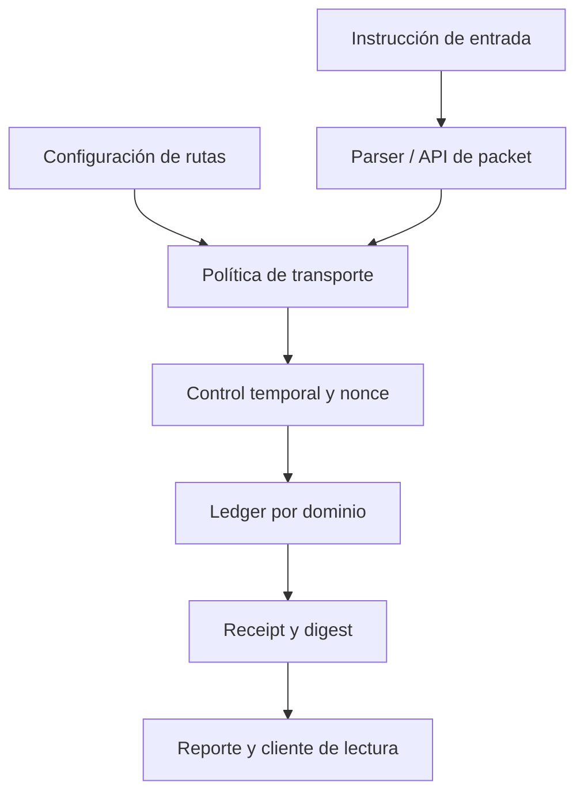

# Política de seguridad

## Alcance

El alcance revisable incluye el motor C de dominios, rutas, ventanas de nonce, ledger, receipts y parser de scripts; también el builder, el cliente de reportes y las pruebas de integración. La ejecución de referencia usa un fixture en memoria y digests deterministas. No implementa firmas criptográficas ni conectividad con una cadena externa; una integración que añada esas capacidades debe definir su propio modelo de autenticación, custodia de claves y confirmación final.

## Límites de confianza

El packet expresa la obligación económica y el envelope de ruta expresa cómo se transporta. Un receipt asocia packet, ruta, relayer y confirmación. La superficie de confianza incluye tanto la configuración previa de rutas como el contenido del packet; el digest determinista sirve para conciliación local, no como sustituto de una firma autenticada.

## Propiedades esperadas

- Una entrega aceptada respeta dominio, destino, fee máximo, expiración y ruta activa.
- Las ventanas de nonce rechazan consumos fuera de rango y duplicados según la política configurada.
- Un rechazo no transfiere fondos y queda visible en el reporte.
- El importe bruto debitado del vault coincide con el neto al beneficiario más el fee del relayer.
- Los receipts aceptados están vinculados a la instrucción y ruta que documentan.
- El suministro agregado se conserva en los flujos nominales; esta propiedad no reemplaza la conciliación por dominio y cuenta.
- El cliente de reportes nunca muta estado y rechaza magnitudes JSON fuera de la precisión segura de JavaScript.

## Verificación

`npm run ci` ejecuta chequeos de formato, build C y pruebas `node:test`. GitHub Actions repite el script en Linux y Windows; Dependabot revisa npm y Actions. Los tests públicos cubren rutas nominales, fallback autorizado, expiración, rechazo, receipts y lectura de reportes. La suite no equivale a una auditoría formal ni cubre transportes o firmantes externos no presentes en este código.

## Reporte responsable

Evita publicar detalles sensibles en issues. Un reporte debe incluir commit, estado inicial, entradas reproducibles, ruta, resultado contable, balances antes/después, impacto y corrección propuesta. Usa el canal privado de seguridad de GitHub cuando esté habilitado o coordina directamente con el propietario antes de divulgar detalles. No adjuntes claves ni datos de terceros.
