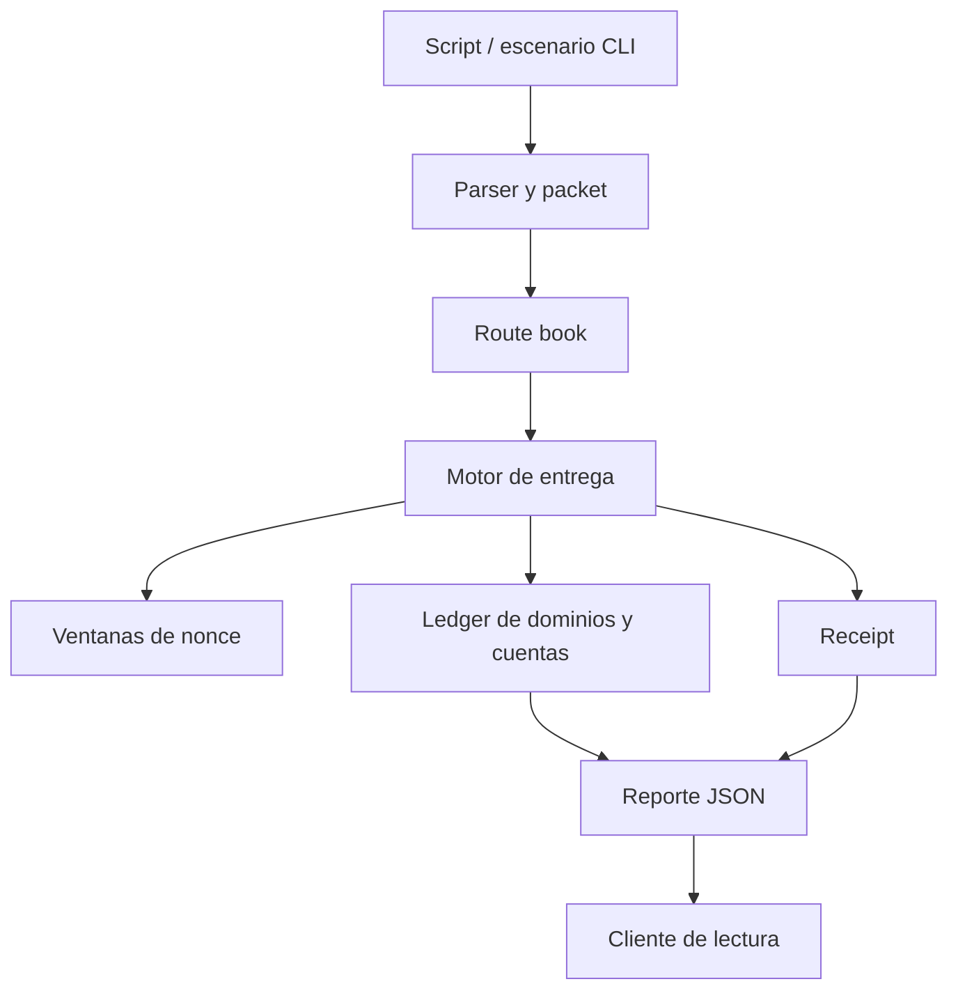

# Arquitectura del relayer

## Componentes y autoridad

`ledger.c` mantiene dominios, cuentas, rutas, packets, receipts y eventos en un estado `ObsLedger`. `routing.c` valida compatibilidad y selecciona rutas conforme a prioridad y fee. `nonce.c` gestiona ventanas por dominio. `transfer.c` valida la entrega y aplica el movimiento económico; `codec.c` produce digests deterministas. `script.c` permite reproducir operaciones con archivos `.obs`, mientras `report.c` expone una vista JSON estable. Ningún módulo necesita una base de datos externa para la ejecución de referencia.

El packet contiene origen económico, destino, nonce, importe, límite de fee, beneficiario, tipo e instante de expiración. La ruta contiene origen de transporte, relayer, fee, plazo máximo, prioridad y estado. Son objetos distintos para permitir rutas alternativas sin cambiar el significado del packet. El receipt identifica la ruta efectivamente usada y conserva su propio digest.

## Fases de una entrega

1. Localizar packet y ruta registrados.
2. Comprobar estado, origen/destino, fee y ventana temporal.
3. Consultar la política de nonce.
4. Debitar el vault del dominio económico y acreditar beneficiario y relayer.
5. Registrar receipt, contadores y digest del estado.

Los errores se devuelven como `ObsStatus` con descripción, y `TRY_DELIVER` permite conservar un rechazo en el reporte sin detener un script completo. El runner es secuencial y determinista; una implementación concurrente necesitaría definir atomicidad y persistencia adicionales.

## Frontera del cliente

`client/report-client.mjs` no se conecta al motor C ni altera el ledger: transforma un JSON ya emitido en filas de liquidez y disponibilidad de rutas. Los importes del protocolo son `uint64_t`; el cliente acepta únicamente enteros JSON representables de forma exacta en JavaScript. Para magnitudes mayores, el consumidor debe parsear con precisión arbitraria desde la fuente original.
