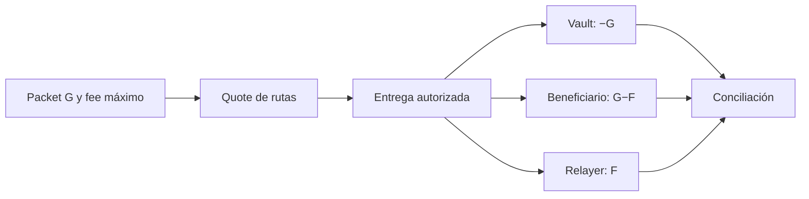

# Modelo económico y conciliación

## Conservación por entrega

Una instrucción de importe bruto `G` y fee `F` cumple `neto = G − F`. La entrega nominal debita `G` del vault de origen, acredita `G−F` al beneficiario y `F` al relayer. Por tanto, el suministro global permanece constante: `Δvault + Δbeneficiario + Δrelayer = −G + (G−F) + F = 0`. El fee debe estar dentro del máximo autorizado por el packet y la ruta debe disponer de liquidez suficiente.

| Concepto                 |  Ruta directa | Ruta alternativa |
| ------------------------ | ------------: | ---------------: |
| Importe bruto de ejemplo | 1 000 000 000 |    1 000 000 000 |
| Fee de referencia        |        20 000 |           25 000 |
| Neto al beneficiario     |   999 980 000 |      999 975 000 |

La tabla compara cotizaciones independientes del mismo importe, no dos pagos acumulados. Las unidades son enteros del ledger; ninguna escala decimal implícita se aplica en el runner.

## Liquidez operativa

Cada dominio publica balance del vault, salida pendiente y liquidez disponible. El route book tiene fee, plazo, prioridad y estado por ruta. El cliente de reportes calcula `utilización_bps = floor(pending_outbound × 10 000 / (available_liquidity + pending_outbound))` para seguimiento, y `success_bps = floor(deliveries × 10 000 / (deliveries + failures))` por ruta. Si el denominador es cero, devuelve cero. Estas métricas describen un reporte ya producido; no autorizan nuevas entregas.

## Ejemplo de lectura

Una entrega directa de 1 000 000 000 con fee 20 000 deja el vault `edge` en 6 500 000 000 desde 7 500 000 000, aumenta `merchant` en 999 980 000 y `relay-edge` en 20 000. El reporte también indica `pending_outbound = 1 000 000 000` y `available_liquidity = 5 500 000 000` para ese dominio; el cliente calcula utilización de 1 538 bps. `conservation_ok` verifica la suma global, pero la conciliación operativa debe comparar también dominios, cuentas, rutas, packets y receipts del período.
